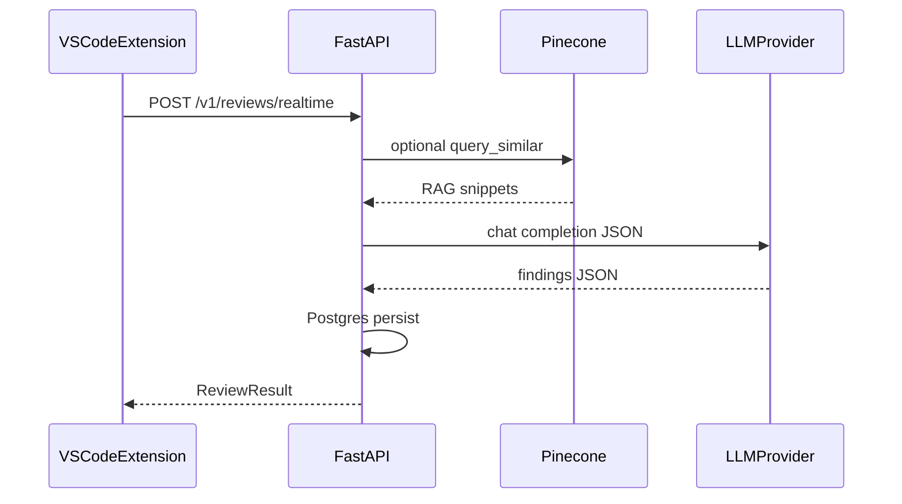

# Architecture

The platform is a **monorepo** with clear boundaries between delivery surfaces (IDE, GitHub, dashboard), orchestration (FastAPI), asynchronous processing (Redis worker), persistence (Postgres), semantic memory (Pinecone + OpenAI embeddings), and LLM providers (OpenAI, Mistral, Ollama-compatible).

## Components

- **Extension** (`packages/extension`): VS Code host that sends snippets or whole files to `/v1/reviews/realtime`, renders diagnostics and a webview for suggested fixes.
- **API** (`apps/api`): Authenticated REST + SSE; validates GitHub webhooks; enqueues PR jobs; exposes metrics and memory debug endpoints.
- **Worker** (`apps/worker`): Consumes Redis jobs for PR reviews and offline eval; talks to GitHub using installation tokens; persists `findings` rows and posts inline PR comments where line mapping is possible.
- **Shared library** (`packages/python-common`): Pipelines, LLM adapters, Pinecone wrapper, SQLAlchemy models, queue helpers.
- **Dashboard** (`apps/dashboard`): Lightweight React UI over `/v1/metrics/summary`.
- **Contracts** (`packages/contracts/openapi.yaml`): API contract; TypeScript SDK (`packages/sdk-ts`) is kept aligned manually.

## Data flow (realtime)

## Analysis layers

The realtime pipeline is hybrid:

1. Deterministic `static.v1` checks for high-signal bug/security/quality patterns.
2. LLM semantic analysis using provider abstraction (OpenAI/Mistral/Ollama).
3. Dedupe by deterministic finding fingerprint.

## Data flow (PR)

GitHub webhook validates HMAC, inserts `reviews` + `idempotency_keys`, enqueues Redis job. Worker exchanges JWT for installation token, iterates changed files, reviews each patch chunk, persists findings, posts a PR summary review, adds inline comments on changed lines, and publishes an optional check run.

## Tenancy

`org_id` is taken from API key mapping (`API_KEYS`) or from `github_installations` / `WEBHOOK_DEFAULT_ORG_ID` for webhooks. Pinecone namespaces are `org:{org_id}:repo:{repo_id}` to prevent cross-repo leakage.
