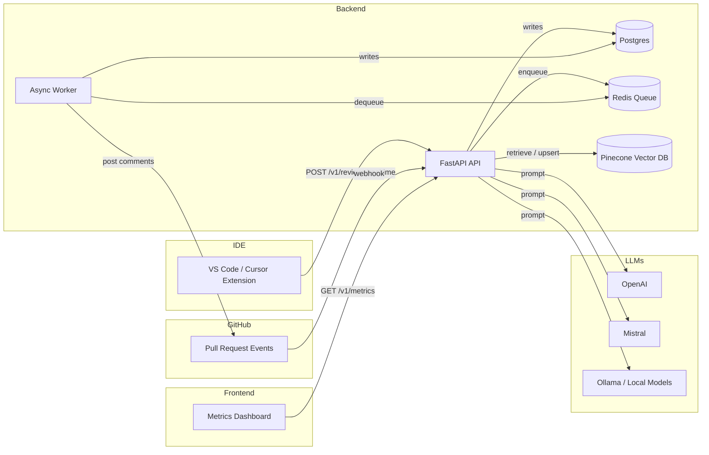
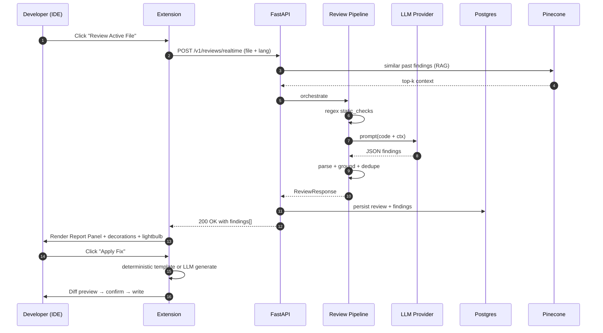
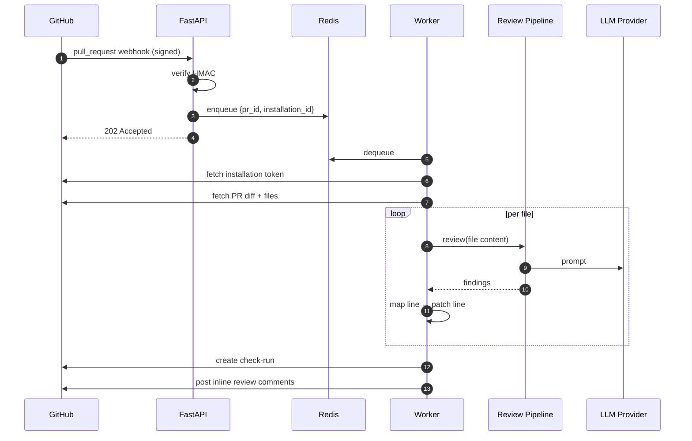

# Project Modules

## Modules and Description

The project is split into **eight core modules**. They are listed below in the order they run when a developer reviews a file.

| # | Module | Description |
|---|---|---|
| 1 | **Authentication Module** | Checks the API key sent by the editor before any code is reviewed. Without a valid key the request is rejected. |
| 2 | **VS Code Extension (Client)** | The buttons inside the editor that let a developer ask for a review, see findings, and click Apply Fix or Reject. Includes status-bar buttons, editor-title icons, a sidebar panel, and a rich Report Panel. |
| 3 | **Backend API** | A FastAPI server that receives the code from the extension, runs the review, saves results, and sends them back. Also serves the dashboard. |
| 4 | **Static Checker** | A simple pattern-matching scanner that flags well-known dangerous code (`eval`, hardcoded passwords, SQL built by string concatenation, bare `except:`). This runs first because it is fast and reliable. |
| 5 | **LLM Review Engine** | Sends the code to a language model (OpenAI, Mistral, or a local Ollama model) and asks for a JSON list of issues. Optionally adds a few similar past findings as context if the memory store is enabled. |
| 6 | **Review Pipeline** | Combines the output of the static checker and the LLM, removes duplicates and weak findings, fills in missing line numbers, and returns the final list. |
| 7 | **Fix Generator** | When the user clicks Apply Fix, this module tries a set of built-in code templates first (for example: rewrite SQL string concat into a parameterised query, wrap unvalidated `input()` in `int(...)` with `try/except`). If no template matches, it asks the LLM for a code-only replacement. Every change is shown in a diff preview before it is written. |
| 8 | **Report & Decorations** | Renders the findings for the developer: a side **Report Panel** with Apply / Generate / Reject buttons, coloured markers next to flagged lines, a yellow light-bulb for quick fixes, and a saved Markdown report under `.codereview/`. |

### Supporting modules (present in the codebase, optional at runtime)

| # | Module | Description |
|---|---|---|
| 9 | **Database** | A Postgres database that stores every review and finding so the dashboard can show totals over time. The system also works without it for one-off local use. |
| 10 | **GitHub PR Reviewer** | When a pull request is opened on GitHub, a webhook reaches the backend and an async worker reviews the changed files and posts inline comments on the PR. This is implemented but only used when the GitHub App is configured. |
| 11 | **Metrics Dashboard** | A small React page that reads from the backend and shows totals such as number of reviews, P95 latency, and severity counts. |
| 12 | **Pre-push Hook** | A git hook script that runs the same review on staged commits before they are pushed and blocks the push if a high or critical issue is found. |

### Honest scope note

- The **static checker, LLM engine, review pipeline, fix generator, report panel, and extension UI** are the parts that actually run on every review and are well exercised.
- The **memory / RAG** part is wired into the LLM prompt but is small in practice; it only helps when the database has a useful history of past findings. The system runs fine with memory disabled.
- The **GitHub PR reviewer, metrics dashboard, and pre-push hook** are present in the repository for completeness but are optional add-ons; they are not required to demo the core review-and-fix flow.

---

## Module Purpose and Functions

### 1. Authentication Module

**Purpose:**
Provides secure access to the code review platform.

**Functions:**
- Validates the bearer API key on every backend request
- Lets developers set or clear their key from inside the editor (stored in VS Code SecretStorage)
- Generates GitHub App JWTs and exchanges them for installation tokens
- Returns clear 401 errors when keys do not match the server configuration

---

### 2. Code Submission Module (IDE Extension)

**Purpose:**
Lets a developer submit code from the editor to be reviewed in one click.

**Functions:**
- Send the active file, a selection, or a saved file to the backend
- Status-bar button, editor-title icons, sidebar buttons, and command palette entries
- Optional automatic review on file save
- Show a progress notification while the review is running
- Block review of generated `.findings.md` / `.findings.json` files

---

### 3. Static Analysis Module

**Purpose:**
Quickly detects well-known dangerous code patterns without calling any model.

**Functions:**
- Detect dynamic SQL built by string concatenation (SQL injection risk)
- Detect `eval()` / `exec()` usage
- Detect hardcoded credentials, passwords, and API keys
- Detect bare `except:` clauses in Python
- Detect insecure `var` usage and other style issues in JavaScript / TypeScript
- Emit findings in the same JSON schema as the LLM so they can be merged

---

### 4. RAG / Memory Module

**Purpose:**
Optionally retrieves similar past findings and feeds them to the LLM as extra context.

**Functions:**
- Embed the incoming code snippet into a vector representation
- Query the Pinecone vector store for top-k similar past findings
- Inject the retrieved context into the LLM prompt
- Scrub PII (emails, tokens, IPs) before any upsert to the vector store
- Toggle with the `enable_memory` flag - the system runs fine without it

---

### 5. LLM Inference Module

**Purpose:**
Sends the code to a language model and parses its response into structured findings.

**Functions:**
- Provider abstraction over OpenAI, Mistral, and Ollama (local)
- Apply a versioned prompt template (`system.reviewer.v1.txt` + `user.realtime.v1.j2`)
- Retry on "model out of memory" errors by trimming the prompt
- Tolerant parser - accepts strict JSON from strong models and Markdown output from weaker ones
- Extract `title`, `detail`, `severity`, `category`, `start_line`, `end_line`, `suggested_fix`

---

### 6. Review Pipeline Module

**Purpose:**
Orchestrates the full review by combining static checks, RAG, and LLM output into one result.

**Functions:**
- Run the static checker first (fast, deterministic)
- Call the LLM provider with the prompt and RAG context
- Parse the LLM response and filter out ungrounded findings (no line / no fix / no CWE)
- Deduplicate findings by "family" and keep the most specific one
- Infer missing line anchors when the model forgets to include them
- Return the final list of findings to the API router

---

### 7. Persistence Module

**Purpose:**
Stores reviews, findings, and evaluation runs so history and analytics are possible.

**Functions:**
- SQLAlchemy models for `Review`, `Finding`, `Organisation`, `GitHubInstallation`, `EvalRun`
- Alembic migrations for versioned schema changes
- Save every review with status, language, timestamp, latency
- Save findings linked to their review
- Provide the data the metrics dashboard reads from

---

### 8. Fix Generation Module

**Purpose:**
Produces a concrete code replacement when the developer clicks **Apply Fix**.

**Functions:**
- Try deterministic templates first (SQL injection, missing input validation, error-handling wrap, bare `except`, hardcoded secrets, context-manager omission, `eval` replacement)
- Fall back to the LLM with a strict code-only prompt
- Sanitize the result so prose is rejected and only valid code is applied
- Show a diff preview before any change is written
- Modify the document only if the developer confirms

---

### 9. Reporting & UI Module

**Purpose:**
Displays findings to the developer in a clear, interactive way.

**Functions:**
- Rich **Report Panel** webview with Apply / Generate / Reject / Go-to-Line buttons per finding
- CodeReview Findings **sidebar** with summary and per-finding Accept / Reject
- Persistent **Markdown report** saved under `.codereview/<file>.findings.md`
- Editor **line decorations** (coloured dot at end of line, overview-ruler stripe)
- **Yellow light-bulb** Code Action for per-line fixes
- **Problems panel** diagnostics (Warning / Information / Hint, never Error)

---

### 10. GitHub Integration Module

**Purpose:**
Reviews pull requests automatically and posts inline comments on GitHub.

**Functions:**
- Receive and verify the GitHub webhook HMAC signature
- Enqueue a PR review job into the Redis queue
- Fetch the PR diff via the GitHub REST API using an installation token
- Run the review pipeline on each changed file
- Map findings to the changed lines in the unified diff
- Post inline review comments and a check-run summary back to the pull request

---

## Module-to-folder map

| Module | Path |
|---|---|
| 1. Authentication | `apps/api/src/codereview_api/auth.py`, `packages/python-common/src/codereview_common/github/auth.py` |
| 2. Code Submission (IDE) | `packages/extension/` |
| 3. Static Analysis | `packages/python-common/src/codereview_common/review/static_checks.py` |
| 4. RAG / Memory | `packages/python-common/src/codereview_common/rag/` (`embeddings.py`, `pinecone_service.py`, `redaction.py`) |
| 5. LLM Inference | `packages/python-common/src/codereview_common/llm/providers.py` + `packages/prompts/` |
| 6. Review Pipeline | `packages/python-common/src/codereview_common/review/pipeline.py`, `apps/api/src/codereview_api/routers/reviews.py` |
| 7. Persistence | `packages/python-common/src/codereview_common/db/`, `infra/migrations/` |
| 8. Fix Generation | `packages/extension/src/extension.ts` (`getDeterministicFix`, `generateFixSuggestion`, `ensureApplicableFix`) |
| 9. Reporting & UI | `packages/extension/src/extension.ts` (`ReportPanel`, `writeFindingsReportFile`, decorations) |
| 10. GitHub Integration | `apps/api/src/codereview_api/routers/webhooks.py`, `apps/worker/src/codereview_worker/main.py`, `packages/python-common/src/codereview_common/github/client.py` |
| 11. Metrics & Analytics | `apps/api/src/codereview_api/routers/metrics.py`, `apps/api/src/codereview_api/routers/eval_router.py`, `apps/dashboard/` |
| 12. Quality-Gate Scripts | `.githooks/pre-push`, `scripts/pre_push_review.py`, `scripts/install_pre_push_hook.py` |

---

## Sequence (how the modules interact on one review)

```
   [2 IDE Extension]
          | submit code
          v
   [1 Authentication] -> reject if API key invalid
          |
          v
   [6 Review Pipeline] --calls--> [3 Static Analysis]
          |                       [4 RAG / Memory] --queries--> Pinecone
          |                       [5 LLM Inference] --calls--> OpenAI / Mistral / Ollama
          v
   merge + ground + dedupe
          |
          v
   [7 Persistence] -> write to Postgres
          |
          v
   [9 Reporting & UI] -> Report Panel + Markdown report + decorations
          |
          v (developer clicks "Apply Fix")
   [8 Fix Generation] -> deterministic template OR LLM
          |
          v
   diff preview -> confirm -> file written
```

For pull requests, modules **10 GitHub Integration** and **6 Review Pipeline** run inside the async worker; the same pipeline is reused, only the input source and output surface differ.

For project leads, **11 Metrics & Analytics** aggregates the rows persisted by module 7 and renders them in the dashboard.

---

## High-level architecture



---

## Module index

| # | Module | Layer | Tech | Path |
|---|---|---|---|---|
| 1 | **API Service** | Backend | FastAPI / Python | `apps/api` |
| 2 | **Async Worker** | Backend | Python / Redis / RQ-style | `apps/worker` |
| 3 | **Metrics Dashboard** | Frontend | React / Vite / TypeScript | `apps/dashboard` |
| 4 | **VS Code / Cursor Extension** | Client | TypeScript | `packages/extension` |
| 5 | **Common Python Library** | Shared lib | Python | `packages/python-common` |
| 6 | **LLM Prompts** | Asset | Jinja2 templates | `packages/prompts` |
| 7 | **API Contracts (OpenAPI)** | Asset | OpenAPI 3.1 / YAML | `packages/contracts` |
| 8 | **TypeScript SDK** | Client lib | TypeScript | `packages/sdk-ts` |
| 9 | **Infrastructure** | DevOps | Docker Compose / Alembic | `infra/` |
| 10 | **Quality-Gate Scripts** | DevOps | Python / Bash | `scripts/`, `.githooks/` |
| 11 | **Documentation** | Docs | Markdown | `docs/` |
| 12 | **Test Suite** | QA | pytest / Jest | `apps/**/tests`, `packages/**/tests` |

---

## 1. API Service - `apps/api`

**Responsibility.** HTTP entry point for all client traffic. Authenticates requests, orchestrates the review pipeline, persists results, exposes metrics, ingests GitHub webhooks.

**Tech.** FastAPI, Uvicorn, SQLAlchemy, Pydantic.

**Sub-modules (routers)**:

| Router | Endpoint family | Purpose |
|---|---|---|
| `routers/reviews.py` | `POST /v1/reviews/realtime`, `GET /v1/reviews/{id}` | Synchronous single-file review used by the IDE extension |
| `routers/webhooks.py` | `POST /v1/webhooks/github` | Verifies GitHub HMAC signature and enqueues PR jobs |
| `routers/metrics.py` | `GET /v1/metrics/summary` | Aggregate metrics (review count, P95 latency, severity histogram) |
| `routers/eval_router.py` | `POST /v1/eval/run`, `GET /v1/eval/runs` | Trigger and list batch evaluation runs |
| `routers/memory.py` | `POST /v1/memory/search`, `POST /v1/memory/upsert` | RAG over the vector DB of past findings |
| `routers/health.py` | `GET /health`, `GET /ready` | Liveness + readiness probes |

**Cross-cutting**:
- `auth.py` - bearer-token API-key check against `API_KEYS` env var.
- `deps.py` - DI helpers (DB session, settings, LLM provider factory).
- `settings.py` - Pydantic-settings reader for env config.
- `main.py` - app factory, middleware (CORS, request-id), router registration.

**Talks to.** `packages/python-common` for pipeline, DB, RAG; LLM providers via HTTP.

---

## 2. Async Worker - `apps/worker`

**Responsibility.** Long-running and batch jobs that must not block HTTP requests, primarily **pull-request reviews** and **offline evaluations**.

**Tech.** Python, Redis (job queue), httpx (GitHub).

**Behaviour.** Polls Redis for jobs, fetches the PR diff from GitHub, splits it by file, runs `pipeline.run_review` per file, maps findings to changed-line numbers in the diff, and posts **inline review comments** + a **check-run summary** back to GitHub.

**Key file.** `apps/worker/src/codereview_worker/main.py` (event loop + PR processing).

**Tests.** `apps/worker/tests/test_pr_line_mapping.py` covers the patch-to-line mapper.

---

## 3. Metrics Dashboard - `apps/dashboard`

**Responsibility.** Small React SPA that visualises reviewer throughput, severity distribution, and recent evaluation runs - intended for project leads, not end developers.

**Tech.** React 18, Vite, TypeScript.

**Key file.** `apps/dashboard/src/App.tsx` consumes `/v1/metrics/summary` and `/v1/eval/runs`.

---

## 4. VS Code / Cursor Extension - `packages/extension`

**Responsibility.** End-user interface for the platform. Submits source code for review, presents findings, and applies fixes inside the editor.

**Tech.** TypeScript, VS Code Extension API.

**Sub-features**:

| Sub-feature | What it does |
|---|---|
| **Status-bar buttons** | `Review`, `Report`, `Fix Line` always visible at the bottom |
| **Editor-title icons** | Play / Wrench / Preview / Go-to-file on every editor tab |
| **Sidebar webview** | "CodeReview Findings" panel under Explorer with Accept/Reject per finding |
| **Report Panel** | Rich webview opened beside the editor with one card per finding (severity badge, current code, expected code, Apply/Generate/Reject/Go-to-Line buttons) |
| **CodeLens** | Buttons above `## headings` inside `.findings.md` reports |
| **Quick-Fix lightbulb** | Per-line Code Actions on findings (Apply / Generate / Reject) |
| **Line decorations** | Coloured dot at end of flagged lines + overview-ruler stripes |
| **Diagnostics** | Findings published to the Problems panel (Warning/Info/Hint) |
| **Diff preview** | Always-on before any code modification |
| **Deterministic fix engine** | Regex templates for SQL injection, `eval`, bare `except`, missing error handling, missing input validation, hardcoded secrets, context-manager omission, etc. |
| **LLM fallback** | Calls backend `/v1/reviews/realtime` for unknown patterns, with progress notification |
| **Git workflow** | `Commit & Push` with auto `git init`, remote prompt, identity prompt |

**Key files.** `src/extension.ts` (single file containing all providers and commands), `package.json` (contributions: commands, menus, views, status bar).

**Docs.** `docs/EXTENSION.md` enumerates every click target and command.

---

## 5. Common Python Library - `packages/python-common`

**Responsibility.** Shared business logic so `apps/api` and `apps/worker` use the same code paths.

**Sub-packages**:

| Sub-package | Responsibility | Key files |
|---|---|---|
| `review/` | Orchestration of static checks + LLM calls + dedup + grounding filters | `pipeline.py`, `static_checks.py` |
| `llm/` | Provider abstraction: OpenAI, Mistral, Ollama (with retry/trim on memory errors) | `providers.py` |
| `rag/` | Retrieval-Augmented Generation - embeddings, Pinecone, PII redaction | `embeddings.py`, `pinecone_service.py`, `redaction.py` |
| `db/` | SQLAlchemy models, base class, session factory | `models.py`, `base.py`, `session.py` |
| `github/` | GitHub App auth (JWT), installation tokens, REST client | `auth.py`, `client.py` |
| `queue/` | Redis-based job queue (enqueue / dequeue / ack) | `redis_queue.py` |
| (root) | Pydantic schemas shared by API + workers | `schemas.py` |

**Review pipeline** (`pipeline.py`) is the analytical core:

```text
       +---------------------+
       |  ReviewRequest      |
       +----------+----------+
                  |
        +---------v---------+
        |  static_checks    |  regex heuristics (eval, hardcoded creds, SQLi, bare except)
        +---------+---------+
                  |
        +---------v---------+
        |  prompt assembly  |  Jinja2 (packages/prompts) + RAG context
        +---------+---------+
                  |
        +---------v---------+
        |  LLM provider     |  OpenAI / Mistral / Ollama
        +---------+---------+
                  |
        +---------v---------+
        |  parse + ground   |  JSON / Markdown tolerant, drops ungrounded findings
        +---------+---------+
                  |
        +---------v---------+
        |  dedupe + score   |  family grouping, specificity ranking
        +---------+---------+
                  |
        +---------v---------+
        |  ReviewResponse   |
        +-------------------+
```

**Tests.** `tests/test_static_checks.py`, `test_redaction.py`, `test_embeddings.py`, `test_github_auth.py`.

---

## 6. LLM Prompts - `packages/prompts`

**Responsibility.** Versioned prompt assets - kept separate from code so prompts can iterate without re-deploying services.

**Files**:
- `system.reviewer.v1.txt` - the persistent reviewer persona + strict output rules (JSON only, grounded findings, code-only `suggested_fix`).
- `user.realtime.v1.j2` - Jinja2 template that interpolates code, RAG context, and per-call instructions.

**Loaded by** `packages/python-common/src/codereview_common/review/pipeline.py`.

---

## 7. API Contracts - `packages/contracts`

**Responsibility.** **Single source of truth** for the HTTP API surface, published as **OpenAPI 3.1**.

**File.** `openapi.yaml` covers every endpoint, request body, response schema, and error type.

**Used by.** `packages/sdk-ts` (code-gen alignment), API consumers, and the dashboard.

---

## 8. TypeScript SDK - `packages/sdk-ts`

**Responsibility.** Thin typed wrapper around the HTTP API for any TypeScript consumer (currently the dashboard; extensible to CI scripts).

**Exports.** `getMetricsSummary`, `listEvalRuns`, etc., plus the matching types (`MetricsSummary`, `EvalRunRecord`, `EvalRunsResponse`).

---

## 9. Infrastructure - `infra/`

| Sub-folder | Contents | Purpose |
|---|---|---|
| `infra/compose/` | `docker-compose.yml`, `.env.example` | Local dev stack: API + worker + Postgres + Redis + dashboard |
| `infra/migrations/` | Alembic `env.py`, `versions/001_initial_schema.py` | Versioned database schema migrations |

**Production target.** Same images can be deployed to Kubernetes (documented in `docs/DEPLOYMENT.md`).

---

## 10. Quality-Gate Scripts - `scripts/` and `.githooks/`

**Responsibility.** Enforce code-review gates and provide developer ergonomics.

| File | Purpose |
|---|---|
| `.githooks/pre-push` | Git hook delegate to `scripts/pre_push_review.py` |
| `scripts/pre_push_review.py` | Reviews changed files via the API and blocks push on high/critical findings |
| `scripts/install_pre_push_hook.py` | Installs the hook; optionally bootstraps `git init` + adds GitHub remote |
| `scripts/send_github_webhook.py` | Local helper to send signed PR webhooks for testing |

**Docs.** `docs/PRE_PUSH_GATE.md`.

---

## 11. Documentation - `docs/`

| Doc | Audience | Topic |
|---|---|---|
| `BLUEPRINT.md` | Architects | Long-form design rationale, phases, schemas |
| `ARCHITECTURE.md` | Engineers | Component diagram + data flow |
| `EXTENSION.md` | End users | IDE click-targets, settings, fix workflow |
| `DEPLOYMENT.md` | Ops | Docker Compose + Kubernetes notes |
| `RUNBOOK.md` | Ops | Incident response, common errors |
| `SECURITY.md` | Security reviewers | Threat model, secret-handling rules |
| `GITHUB_APP.md` | Integrators | Setting up the GitHub App + webhooks |
| `PRE_PUSH_GATE.md` | Developers | Hook setup + bypass behaviour |
| `MODULES.md` *(this file)* | Supervisor | Module breakdown |

---

## 12. Test Suite

| Test file | Module under test |
|---|---|
| `apps/api/tests/test_health.py` | API liveness |
| `apps/api/tests/test_ready_integration.py` | API + DB + Redis readiness |
| `apps/worker/tests/test_pr_line_mapping.py` | Worker diff → line mapping |
| `packages/python-common/tests/test_static_checks.py` | Deterministic regex checks |
| `packages/python-common/tests/test_redaction.py` | PII scrubber before vector upsert |
| `packages/python-common/tests/test_embeddings.py` | Vector encoder shape & determinism |
| `packages/python-common/tests/test_github_auth.py` | App JWT + installation token cache |

---

## Data flow (single review)



---

## Data flow (GitHub PR)



---

## Why this layering matters

1. **Separation of concerns.** Each module owns one responsibility. Replacing the LLM provider requires touching `packages/python-common/llm/`; nothing else changes.
2. **Re-use.** `apps/api` and `apps/worker` share the same pipeline via `packages/python-common`.
3. **Contract-first.** `packages/contracts/openapi.yaml` lets the dashboard, SDK, and extension evolve independently from the server implementation.
4. **Asset versioning.** Prompts live in `packages/prompts`, so prompt iteration is auditable in git and doesn't require code changes.
5. **Defence in depth.** Static regex checks, LLM analysis, RAG grounding, and post-hoc dedupe all run inside the pipeline so no single layer is solely responsible for quality.
6. **Multi-surface UX.** End users get findings via the IDE extension, supervisors via the dashboard, and GitHub PRs via inline comments - all from the same backend.

---

## Suggested presentation order for supervisor

1. **High-level diagram** (top of this doc) - one slide.
2. **Module index table** - one slide.
3. **API Service + Common Library** - explain the pipeline diagram in section 5.
4. **VS Code Extension features table** in section 4 - demo time.
5. **GitHub PR flow** sequence diagram - one slide.
6. **Infrastructure + Tests + Documentation** - tooling story.
7. **Future work**: stronger LLMs (qwen2.5-coder), wider language support (currently best for Python / JS / TS), team-level dashboards, fine-tuning on team-specific style guides.
